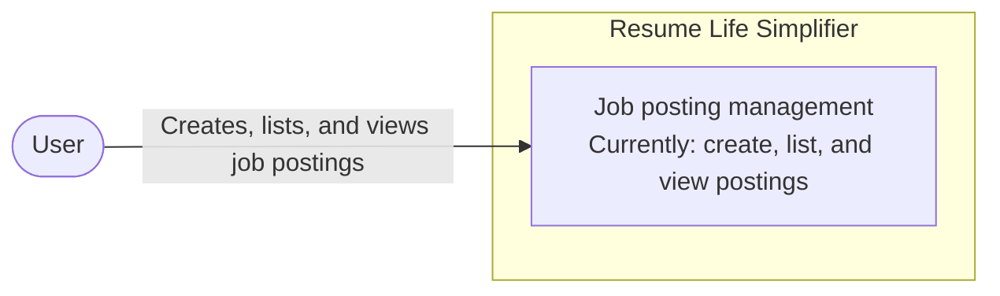
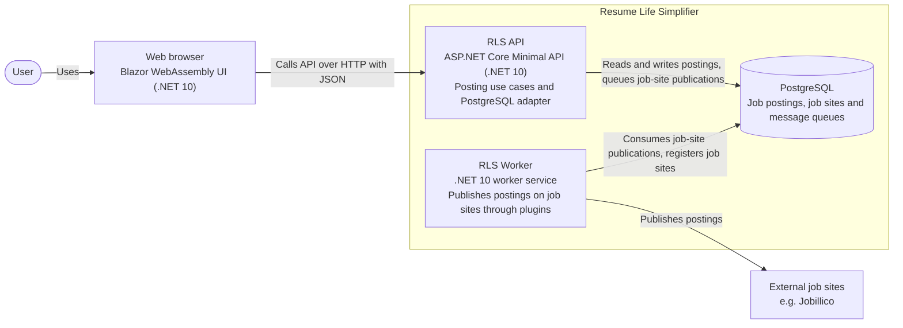

# System Name
Resume life simplifier

# Contributors
- [Stéphane Denommé](https://github.com/CurlyFire)
- [Julien-Claude Diallo](https://github.com/AI-nakinSkywalker)

# Project Board
https://github.com/orgs/dialden/projects/3

# Licence
MIT

## System structure

### Architecture diagrams

#### System context diagram


#### Container diagram


## Tech stack
Programming language: C#

Frameworks: .Net 10, Blazor webassembly

Database: PostgreSQL

## UI flow

From Home, choose **View postings** to open the postings list. Choose
**Create posting** from that list, enter a title, and submit the form.
Successful creation returns to the refreshed postings list; errors remain on
the creation page. Select a posting's title in the list to view its details.
The creation and details pages link back to the postings list.

The UI uses a responsive career-workspace layout with persistent **Overview**
and **Job postings** navigation, an opportunity library with a live posting
count, and dedicated creation and detail panels. Navigation moves above the
content on smaller screens. Loading, empty, and error states are shown in
context; the interface only displays the posting information currently supported
by the system.

UI acceptance-test page objects inherit shared workspace navigation from
`BasePage`. The UI client loads the app once with Playwright's `GotoAsync`;
subsequent returns home click **Overview**, allowing Blazor to navigate without
restarting the WebAssembly app.

### Publishing and external destinations

Select a draft posting in the library and choose **Publish selected**. In the
confirmation dialog, optionally select Jobillico and choose **Confirm
publication**. **Cancel** closes the dialog without publishing or saving channel
choices. With no destinations selected, publication is
local to RLS. A published posting cannot be published again; the UI disables the
action and the API returns HTTP 409 for another attempt.

The dialog's **Publishing channels** section uses selectable job-site cards and
a production-publication notice. Publication errors remain in the dialog; its controls are disabled
while publication is in progress.

The API advertises `GET /job-sites` through the `list-job-sites` entry-point link.
It returns the job sites registered by the Worker, for example
`[{"id":"jobillico","name":"Jobillico"}]`, and none until the Worker has started once. Publish with
`PATCH /postings/{id}`:

```json
{
  "status": "Published",
  "jobSiteIds": ["jobillico"]
}
```

Omitting `jobSiteIds` is equivalent to an empty selection. Identifiers are
case-sensitive; unknown, duplicate, or null selections return HTTP 400 with a
`jobSiteIds` validation error. The posting's publication and its per-site
job-site publication requests are saved atomically. Concurrent publication
attempts cannot create duplicate job-site publications.

Publishing, viewing, and listing responses include `jobSitePublications`, for example
`[{"jobSiteId":"jobillico","status":"Pending"}]`. A publication stays `Pending` until
the Worker gets the job site's response, then becomes `Succeeded` or `Failed`; the
publish response is therefore always `Pending`. The UI shows these outcomes in
the list and posting details. Postings without external destinations have an
empty `jobSitePublications` collection.

Publication saves a MassTransit command for each selected site in the EF Core
transactional outbox, in the same transaction as the posting and job-site
publication records. The API does not wait for transport delivery. The Worker
forwards committed commands to the durable PostgreSQL queue
`rls-job-site-publication`; pending outbox work is retried and survives restarts.
Publishing without external destinations creates no job-site publication commands.

### Worker and job-site plugins

The Worker (`DialDen.RLS.Worker.Root`) is a separate process. It consumes the
job-site publication commands and publishes each posting on its job site through
a plugin. A plugin implements `IJobSite` from `DialDen.RLS.JobSites.Abstractions`
(identifier, name, and `Publish`). In real mode, the Worker scans shipped
`DialDen.RLS.JobSites.*.dll` assemblies for concrete implementations. Worker.Root
keeps project references to deploy the plugins; it does not call provider-specific
registration methods. The Jobillico plugin (`DialDen.RLS.JobSites.Jobillico`)
posts English jobs as UTF-8 XML to `https://www.jobillico.com/api/push`.

Plugins may expose a public, parameterless `IJobSitePlugin` entry point to register
their own dependencies through a plugin-owned `IServiceCollection` extension
(for example, named HTTP clients and authentication settings). Discovery invokes
these entry points before registering `IJobSite` implementations as transient
services. Stub implementations live outside the scanned assemblies. Only ship
trusted plugin assemblies; there is no hot reload or plugin isolation.
Invalid plugin entry points, unresolved site dependencies, and duplicate site
IDs fail startup rather than silently skipping providers.

At startup, the Worker registers its plugins in the `job_sites` table. Job sites
it no longer has are kept but become unavailable, so the API stops offering them.
Run a single Worker per database; Workers with different plugins would undo each
other's registrations.

When a job site rejects a posting (the plugin throws), its publication becomes
`Failed` without retrying. A publication whose job site is unavailable also
fails. The Worker's own errors, such as a lost database connection, are retried
a few times, then the command moves to the queue's error queue. Each command is
processed at most once, in the same transaction as its publication's outcome,
through MassTransit's EF Core inbox. The plugin is called within that
transaction, which is acceptable for the demo.

The Worker reads configuration from environment variables prefixed with
`RLS_WORKER_` and command-line arguments, like the API. It requires
`ConnectionStrings:RLS`. `Messaging:JobSitePublicationQueue` (default
`rls-job-site-publication`) names the queue, and must match the API's setting.
Commands queued while the Worker is stopped are processed when it starts.

Like the sandbox's clock provider, the Worker selects its job-site provider from
configuration:

```sh
# Default: register real providers.
RLS_WORKER_JobSites__Type=real

# Test/demo: register "stub-job-site" / "Stub Job Site" using HTTP.
RLS_WORKER_JobSites__Type=stubbed
RLS_WORKER_JobSites__Sites__0__Id=stub-job-site
RLS_WORKER_JobSites__Sites__0__Name="Stub Job Site"
RLS_WORKER_JobSites__Sites__0__Url=http://wiremock-job-site/
```

Stubbed mode skips real-plugin discovery and creates one HTTP-backed site per
`JobSites:Sites` configuration entry. Each requires a distinct, case-sensitive
ID, display name, and absolute HTTP(S) URL without a query or fragment. An empty
list fails startup. Add further sites using indexes `1`, `2`, and so on.

The devcontainer Compose configuration explicitly selects `real` for the
development Worker. Real-external-system tests inherit this setting; stubbed
tests override it through their prefixed environment variables.

The small `StubJobSite` implementation lives in `DialDen.RLS.Worker.Root`,
alongside its configuration, rather than in a separate plugin project or the tests.
It sends `POST /publish/<configured-site-id>?postingId=<id>`; a successful HTTP status
means accepted, while a non-success status fails publication. Unsupported types
or an invalid/missing HTTP URL prevent startup. Stubbed mode is opt-in and should
only be enabled in test/demo environments.

### Jobillico manual publishing

New postings require a description through both API and UI. `POST /postings`
accepts `title` and `description`; creation, viewing, and listing return the
description. Migration V9 preserves existing postings with an empty description,
without inventing content; Jobillico may reject such older postings.

The plugin maps the posting title and description to `stitle_en` and
`sdescription_en`, sets `elang=en`, and sends no French fields. Recruiter and
location identifiers, creator (the username), and authentication are configuration,
not posting data. XML text is escaped safely, including special characters.
The local posting ID is sent as `srefnumber`; it is not an exactly-once guarantee.

For manual testing in the devcontainer, set these in the Git-ignored
[.env.local](.devcontainer/.env.local), then rebuild the container:

```sh
RLS_WORKER_Jobillico__Username=<your-username>
RLS_WORKER_Jobillico__Password=<your-password>
RLS_WORKER_Jobillico__RecruiterId=<recruiter-id>
RLS_WORKER_Jobillico__LocationId=<location-id>
```

Create the local file if absent. Do not commit credentials or paste them into
chat. Compose loads these Worker variables through the dev service's optional
`env_file`; the tracked `.env` retains shared settings only.
Missing credentials or invalid IDs prevent the real Worker from starting.

**The development Compose configuration explicitly sets
`RLS_WORKER_Jobillico__UseProduction=true`, sending `bsandboxoff=1`.
Confirming publication to Jobillico can create a live job.**
The plugin defaults to sandbox unless production is explicitly selected; the
Jobillico sandbox is reported unavailable. Start API + Worker + UI, create a
posting with an English description, select Jobillico when publishing, and
refresh the posting details to observe the outcome.

HTTP success alone is not acceptance: any XML `error` element fails publication.
Success requires one `results/job` with a positive `ijob`. HTTP errors, malformed
XML, missing/invalid identifiers, and timeouts also fail publication. Responses
and credentials are not logged by the plugin.

The existing acceptance tests cover required descriptions and generic job-site
publication through the existing real/stubbed test environments. Real-system
smoke tests inherit the normal Jobillico endpoint and credentials;
they only check readiness and do not publish jobs. Verify actual Jobillico submission manually through
RLS. No automated test submits to Jobillico production.

Apply all Flyway migrations, including
[V3](src/system/Database/migrations/V3__Add_posting_deliveries.sql),
[V4](src/system/Database/migrations/V4__Add_messaging_transport_and_outbox.sql),
[V5](src/system/Database/migrations/V5__Queue_existing_pending_deliveries.sql),
[V6](src/system/Database/migrations/V6__Rename_deliveries_to_job_site_publications.sql),
[V7](src/system/Database/migrations/V7__Pin_job_site_publication_message_type.sql) and
[V8](src/system/Database/migrations/V8__Add_job_sites.sql),
before running the updated API, Worker or tests.
V5 queues previously recorded Pending job-site publications without duplicating commands
already present in the outbox or destination queue. V6 renames the deliveries table
to `job_site_publications` and the queued command to `PublishPostingOnJobSite`.
V7 moves queued commands to the command's pinned message type,
`urn:message:DialDen.RLS.Messaging:PublishPostingOnJobSite`, and V8 adds the
`job_sites` catalog. Stop API and Worker hosts while applying the migrations.

### Posting pagination

The posting library uses server-side paging with **10 postings per page**, ordered
by identifier. The badge shows the total number of postings, not just the current
page's size. Previous/Next links and a range such as **Showing 11-20 of 23
postings** identify the current slice. Page links use `/postings?page=2`, so
refreshing or using browser history preserves the selected page. Creating a
posting returns to the first page; newly created postings appear at the end of
the identifier-ordered library.

`GET /postings?pageNumber=2` returns a page envelope rather than the previous flat
array (an API response-shape change):

```json
{
  "items": [{ "id": 11, "title": "Software Engineer" }],
  "totalCount": 11,
  "pageNumber": 2,
  "pageSize": 10
}
```

Omitting `pageNumber` selects page 1. Non-positive, non-integer, or out-of-range
integer page numbers return HTTP 400. A valid page number beyond the last page
returns an empty `items` array with the actual `totalCount`. EF Core reads the
count and the limited page in a repeatable-read transaction, keeping both values
consistent for that request.

Core represents identified opportunities with `Posting` and listing results with
`PostingList` (`Postings` and `TotalPostings`). Its `IPostingsArchive` contract uses
page numbers and postings per page; the `EntityFrameworkPostingsArchive`
infrastructure adapter owns pagination and persistence through a scoped EF Core
context. Core and its contracts remain independent of EF Core.

### Persistence

Application persistence uses EF Core with the Npgsql PostgreSQL provider, rather
than direct Npgsql commands. The context maps the existing `postings` table,
including its identity identifier and text-based posting status. The
`ConnectionStrings:RLS` setting remains unchanged.

Flyway remains the schema owner. Application startup does not create the
database, run EF migrations, or modify its schema. Continue adding schema changes
under `src/system/Database/migrations`. Test database safety checks and cleanup
continue using the underlying Npgsql driver.

### Background messaging

MassTransit **8.5.12** is pinned for this POC. Its packages declare Apache-2.0
licensing and provide .NET 10 / EF Core 10 support. MassTransit v9 requires a
commercial license; upgrading to v9 is not part of this implementation.

The transport reuses `ConnectionStrings:RLS`, with its objects in the `transport`
schema. EF outbox/inbox tables live in `messaging`. These schemas are separate
from the application tables in `public`, but use the same PostgreSQL database.
No separate message broker or additional connection setting is required.

Flyway V4 contains the PostgreSQL transport SQL derived from the pinned
MassTransit version and outbox DDL generated from its EF model. The transport
SQL's [Apache license](src/system/Database/licenses/MassTransit-LICENSE.txt) is
included. Application startup does not create or migrate these schemas.
Coordinate future MassTransit package upgrades with a new Flyway migration;
do not edit an already-applied migration. The migration account needs schema,
table, sequence, and function creation permissions. The runtime account needs
access to the messaging/transport tables and sequences and permission to execute
transport functions.

The API only writes commands to the outbox. The Worker runs the outbox delivery
service and the consumers. Dispatch is at-least-once; the Worker's inbox and the
publication's `Pending` status ignore repeated commands.

## Repository Strategy
Mono-Repo

# Contribute
## Software requirements
### Windows
- [Windows Subsystem for Linux](https://learn.microsoft.com/en-us/windows/wsl/install)
- [Docker desktop](https://www.docker.com/products/docker-desktop/)
- [Visual Studio Code](https://code.visualstudio.com/)
    - [Dev containers extension](https://marketplace.visualstudio.com/items?itemName=ms-vscode-remote.remote-containers)
- [VcXsrv - Open-Source X Server for Windows](https://vcxsrv.com/)

### Linux
- Docker
- [Visual Studio Code](https://code.visualstudio.com/)
    - [Dev containers extension](https://marketplace.visualstudio.com/items?itemName=ms-vscode-remote.remote-containers)

## Build, run and test the application
### Prerequisites
- Make sure you have installed the [software requirements](#software-requirements)
- Clone the repository
- Open the cloned folder within Visual Studio Code
- Reopen the folder inside a devcontainer (Visual Studio's Dev container extension should detect the devcontainer configuration)

### Configure the development environment
The dev container reads its local settings from
[`.devcontainer/.env`](.devcontainer/.env). Edit that file before creating or
rebuilding the container:

| Variables | Purpose |
|-----------|---------|
| `POSTGRES_DB`, `POSTGRES_USER`, `POSTGRES_PASSWORD` | Local PostgreSQL setup |
| `RLS_DEV_DATABASE`, `RLS_TEST_DATABASE` | Separate databases for development and tests |
| `PGHOST`, `PGPORT` | PostgreSQL address used inside the Compose network |
| `API_HTTP_URL`, `API_HTTPS_URL`, `UI_HTTP_URL`, `UI_HTTPS_URL` | API and UI launch URLs |
| `API_PROJECT_FILE`, `UI_PROJECT_FILE` | Project filenames used to generate VS Code launch settings |
| `ASPNETCORE_ENVIRONMENT` | ASP.NET Core environment |
| `TEST_HOSTING_MODE` | Test hosting mode: `InProcess` (default) or `External` |

The checked-in `.env` contains disposable local-development defaults. Do not put
production credentials in it. If `TEST_HOSTING_MODE` is `External`, configure
`RLS_TEST_Hosting__APIUrl` and `RLS_TEST_Hosting__UIUrl` in the container
environment as well. Rebuild the dev container after changing environment
values; setup regenerates the Git-ignored launch settings. See the
[development container guide](.devcontainer/README.md) for details.

### Build and run the application
- Make sure you have completed the [Prerequisites](#Prerequisites)
#### From Visual Studio Code
- Select **API + Worker + UI** in Run and Debug and press F5. It starts the API, the Worker and a browser on the UI address

### Build and run the tests
- Make sure you have completed the [Prerequisites](#Prerequisites)

The shared acceptance-test fixture empties `job_site_publications`, `postings`,
outbox/inbox records, and transport message/delivery records and resets the
posting identity sequence once before each test run (including filtered runs).
It preserves schemas, transport topology and the `job_sites` catalog, and does
not clear data between scenarios. Cleanup requires
`RLS_TEST_DATABASE` and `RLS_DEV_DATABASE` and refuses connections that do not
target the named test database or that target the development database.
Real and Stubbed connections are checked before cleanup; identical connections
are cleaned only once. Do not run simultaneous test runs against the same
database. With external hosting, ensure the external API uses this same test
database configuration.

With in-process hosting, each test environment also hosts the Worker, started
before the API, with its own queue (`rls-job-site-publication-stubbed` or
`-real`) so the environments never consume each other's commands. The Worker
reads `<ENVIRONMENT>_RLS_WORKER_` variables, such as
`STUBBED_EXT_SYSTEMS_RLS_WORKER_ConnectionStrings__RLS`. The stubbed environment
reads `STUBBED_EXT_SYSTEMS_RLS_WORKER_JobSites__Type=stubbed` and
`STUBBED_EXT_SYSTEMS_RLS_WORKER_JobSites__Sites__<index>__Id`, `Name`, and `Url`
from the environment. Compose configures `stub-job-site` (**Stub Job Site**) and
`another-stub-job-site` (**Another Stub Job Site**). Scenarios configure each site's
response with `Given().JobSite("stub-job-site").AcceptsPostings()` or
`.RejectsPostings()`. Processing scenarios publish in When and assert
`EventuallyHasJobSitePublication(...)` in Then: they observe the expected final
status for up to 30 seconds, failing immediately on an opposite final outcome.
View/list scenarios use `Given().Posting().PublishedOnJobSite(...)` to establish
a successfully completed publication through the system; setup publishes and
waits internally. `PublishedTo(...)` only requests publication. Each scenario resets
the WireMock mappings and request journal; configured sites accept postings by
default unless a scenario overrides the response. The WireMock admin URL is configured with
`RLS_TEST_JobSites__WireMockUrl` and defaults to `http://wiremock-job-site/` in
the dev container.

An externally deployed Worker uses the same executable with
`RLS_WORKER_JobSites__Type=stubbed` and each `RLS_WORKER_JobSites__Sites__<index>__Url`
set to its reachable WireMock URL. Tests configure the admin URL separately with
`RLS_TEST_JobSites__WireMockUrl`; all URLs must reach the same WireMock server
but may differ across networks. No test-only Worker composition is needed.
The commit stage builds API, UI and Worker images and runs acceptance/smoke tests
against their containers in External hosting mode. Each run creates a private
Docker network and WireMock container, configures the Worker as `stubbed`, and
uses an isolated publication queue shared by API and Worker. Tests reach WireMock
through its published host port; the Worker uses its Docker-network address.
Startup checks cover WireMock, API, UI and the Worker's job-site registration.
Containers and the network are removed after the run, including on test failure.
`--push-images` publishes all three application images after tests pass.

The [commit-stage entry script](ops/pipelines/stages/commit/invoke.cs) expresses
the workflow as named steps, with the `CommitStage` class defined below them
in the same script. A single `#:project` directive references the
[shared library](ops/pipelines/shared/DialDen.RLS.Pipelines.csproj), which contains
reusable process execution, logging, workspace/configuration loading, image-version
validation, and Google Cloud authentication checks. The commit
script itself has no project file.

### Release pipeline

Run the [release-stage script](ops/pipelines/stages/release/invoke.cs) from the
authenticated dev container:

```sh
ops/pipelines/stages/release/invoke.cs --version <image-tag> --target-environment dev
```

The stage currently verifies Google Cloud authentication and the configured
project number, then enables the Artifact Registry and Secret Manager APIs in
that project. It creates the project-wide `ghcr-read-token` secret if missing,
with replication in the configured region. It ensures Artifact Registry's
Google-managed service identity exists and grants it Secret Accessor on that
secret only, allowing the future remote repository to read the GitHub token.
No token value is added; existing values and other IAM bindings are preserved.
These steps are safe to repeat.
Google may take time to propagate a newly created service identity. If the
permission grant reports that the service account does not exist, wait briefly
and rerun the release; the script stops rather than ignoring the failed grant.
It creates the project-wide `ghcr` Docker remote repository in the configured
region, using `https://ghcr.io` as its upstream and the username from
`googleCloud.registry`. The repository references the newest enabled token
version without reading its value. Reruns verify the existing repository's type
and upstream and update its credentials reference when the token is rotated.
An existing incompatible repository causes the release to fail rather than
replace it. Cloud SQL instance setup follows image verification; no application
deployments are created yet.
The stage reads the API, UI and Worker manifests through the remote repository
to verify access to the requested image version. This populates the registry
cache and fails if any image is missing or inaccessible. Immutable image
references are recorded in the run's `.artifacts/release/<environment>/.../images.json`.
The caller needs permission to enable services (`serviceusage.services.enable`)
and to list and create secrets (`secretmanager.secrets.list` and
`secretmanager.secrets.create`), generate service identities
(`serviceusage.services.generateServiceIdentity`), and read and update the
secret's IAM policy (`secretmanager.secrets.getIamPolicy` and
`secretmanager.secrets.setIamPolicy`).
Repository setup also requires listing, creating and updating Artifact Registry
repositories and listing secret-version metadata.

#### Demo database configuration

The `googleCloud.database` section of
[config.json](ops/pipelines/config.json) is validated before any cloud operations.
It selects PostgreSQL 16, Enterprise edition, `db-f1-micro`, 10 GB HDD storage,
and single-zone availability. Storage auto-increase, automated backups and
point-in-time recovery are disabled to minimize demo costs; deletion protection
is enabled. This has no high availability or automated data recovery and is not
a production configuration. The settings currently apply to every environment;
the environment name alone does not select a different database profile.
After verifying the images, the release enables the Cloud SQL Admin API and
creates `rls-<environment>` if missing. This starts billable Cloud SQL capacity.
It waits for creation and checks the instance state and configured settings.
Existing instances with mismatched settings cause an explicit failure; the
script does not resize or replace them. The instance has a public IP with no
authorized networks and requires encrypted connections; subsequent migration
and runtime steps will use Cloud SQL Auth Proxy or the managed connector.
The discovered connection name is saved to the run's `database.json`.
The caller needs permission to enable the API and list, create and inspect
Cloud SQL instances. The release then creates the `rls` application database if
missing and verifies UTF8 encoding without modifying existing data. The caller
also needs permission to list, create and inspect Cloud SQL databases.
The release then creates `rls-<environment>-db-migrator-password` and
`rls-<environment>-db-app-password` in Secret Manager, each with a separate
cryptographically generated 256-bit password. Values travel through stdin,
not command arguments, logs or artifact files. Existing enabled versions are
reused without reading the passwords or adding versions. If a password secret
has versions but none enabled, the release fails instead of generating a
replacement that could break an existing database login. Releases against the
same environment must not run concurrently. This step also requires listing
secret versions and adding a version for initial setup.
The release creates the built-in `rls_migrator` user with its stored password.
Cloud SQL's default elevated built-in-user privileges are reserved for this
migration account, never for application runtime. Password data is read into
memory and passed to `gcloud` as JSON through `/dev/stdin`, not through arguments
or a temporary file. This requires the Linux dev container, secret-version
access, and Cloud SQL user list/create permissions. Existing migration users
are left unchanged; an out-of-band password change is not automatically repaired.
User existence is checked through the administration API; actual database login
is verified by starting Cloud SQL Auth Proxy on a free loopback port and checking
`current_user` with `psql` against the `rls` database. The password is passed to
the client as an environment variable and is not included in its logged arguments.
The proxy is stopped when the check completes or fails.
The release creates `rls_app` directly in PostgreSQL rather than using the Cloud
SQL built-in user API, which would automatically grant `cloudsqlsuperuser`.
Its password must have the generated hexadecimal format, is passed only through
SQL stdin, and is never placed in arguments, logs, or files. The release verifies
that it can log in and has no elevated role attributes or memberships. Runtime
data-access permissions are granted only after migrations.

#### Release migrations

Before any cloud operations, the release exports
`src/system/Database/migrations` from the Git commit identified by `--version`,
using `git archive`. The version must also resolve to a locally available Git
commit or tag; CI image versions are commit SHAs. Fetch a missing commit before
releasing it. The working checkout and uncommitted SQL edits are not used or
changed. Exported SQL is kept under the run's `release-source` directory and the
resolved commit is recorded in `migration-commit.txt`. Missing commits or SQL
files stop the release.

After provisioning and verifying both database logins, the release runs Flyway
`migrate` as `rls_migrator` through Cloud SQL Auth Proxy, using only the exported
SQL. An explicit `flyway-release.toml` in that export enables migration-name and
checksum validation, disables clean and automatic baselining, and rejects
out-of-order migrations. Inherited `FLYWAY_*` and `PG*` settings are removed from
the migration process before injecting the release password in its environment.
The checkout's development Flyway configuration is not used. Failed migrations
stop the release, and the proxy is stopped on success or failure. Reruns validate
the schema history and apply only pending migrations; no repair or clean is
performed automatically.

Demo releases may apply migrations while the API and Worker are running. There
is no maintenance confirmation or stopped-Worker prerequisite. Incompatible
schema changes can cause request failures or interrupt processing; prefer
backward-compatible migrations or manually stop applications when needed.

After migrations, the release grants `rls_app` database connection access, usage
of `public`, `messaging` and `transport`, table SELECT/INSERT/UPDATE/DELETE,
sequence USAGE/SELECT, and execution of transport functions. MassTransit creates
queue/topic topology through those functions using table writes, not schema
creation. Matching default privileges cover future tables and sequences created
by `rls_migrator` in these schemas, and future transport functions. New schemas
or objects created by another role require an explicit permission update.
Flyway's `public.flyway_schema_history` is excluded from runtime access.
Grants are transactional and repeatable; the release verifies effective
permissions using the real `rls_app` login and fails for missing privileges,
schema/database creation rights, table ownership, elevated table privileges or
Flyway-history access. No ownership, schema creation or elevated roles are
granted. Passwords remain in child-process environments, never logged arguments.

#### Runtime database connection

The release then stores the API/Worker Npgsql connection string in
`rls-<environment>-db-connection`, using the `rls_app` password and the Cloud SQL
Unix socket directory `/cloudsql/<instance-connection-name>` on port 5432.
Client SSL is disabled for this local socket; the managed Cloud SQL connector
provides encrypted transport to the instance. Pooling is enabled with a minimum
of zero and maximum of ten connections **per pool**, not a database-wide limit.
Application instance counts and MassTransit/EF pools must be budgeted together
before deployment to the small demo instance.

The value is built in memory and uploaded via stdin, never written to artifacts
or included in logged arguments. An unchanged value reuses the latest version;
a changed value adds a version without deleting older versions. An inaccessible
or disabled latest version fails explicitly instead of being replaced silently.
This does not rotate database passwords. Both Cloud Run services and worker
pools support the Cloud SQL attachment needed to expose this socket.
For Unix-socket connections, Infrastructure configures MassTransit's transport
host identity as `localhost` while preserving the original Npgsql connection
string. This avoids MassTransit's host parser interpreting the colons in the
socket directory as TCP host/port separators. The transport still connects
through the Unix socket, not TCP. Normal TCP configuration is unchanged.

#### Runtime identities

The release enables the IAM API and creates or reuses three keyless service
accounts: `rls-<environment>-api`, `rls-<environment>-wrk` and
`rls-<environment>-ui`. The shortened `wrk` suffix keeps IDs within Google's
30-character limit even with a 20-character environment name. Disabled accounts
cause an explicit failure rather than being re-enabled.

API and Worker receive `roles/cloudsql.client` at project scope (connection
access to this project's Cloud SQL instances, not PostgreSQL data privileges),
and `roles/secretmanager.secretAccessor` only on their environment's
`rls-<environment>-db-connection` secret. The UI receives neither grant.
No runtime identity receives access to database password secrets or the GHCR
token through this script. Existing unrelated IAM bindings are not removed;
review inherited or manually granted permissions separately.
Bindings are repeatable and account emails are saved in
`runtime-identities.json`, without credentials. IAM changes may take time to
propagate; if Google rejects a newly created principal, rerun the release.
No service-account keys or impersonation grants are created. The release caller
needs service-account list/create/inspect permissions, project IAM policy
read/write, and IAM policy read/write on the connection secret. Later deployment
also requires the caller to have `iam.serviceAccounts.actAs` on these accounts;
the script does not grant that privilege to itself.

#### Worker job-site configuration

The `googleCloud.jobillico` section of [config.json](ops/pipelines/config.json)
contains the HTTPS endpoint, recruiter/location IDs and production-mode flag.
These settings are validated before cloud operations and currently apply to
every target environment, including `dev`; the environment name does not select
Jobillico sandbox mode. With `useProduction: true`, a deployed Worker can publish
real postings.

Supply credentials separately in `rls-<environment>-jobillico-username` and
`rls-<environment>-jobillico-password` through Secret Manager. The release
requires an enabled version of both secrets and grants access only to the
Worker service account, not API or UI. It neither creates credentials nor reads
their values. Selected numeric version references (not values) are recorded in
`worker-job-site-secrets.json` for subsequent deployment. The caller needs
secret-version list and secret IAM policy read/write permissions for these
secrets.

#### Worker deployment

The release deploys `rls-<environment>-worker` with the resolved image digest,
Worker service account, managed Cloud SQL Unix-socket attachment, production
settings from `googleCloud.jobillico`, and numeric versions of its three secrets.
There is one application container, with 1 CPU and 512 MiB memory, and no proxy
sidecar. A Worker image containing the Unix-socket transport-host fix is required;
the previously published image does not support this connection.

The generated `worker-definition.json` contains settings and secret references,
not credential values. The definition is applied with zero instances, then
scaled to one; `worker.json` captures the resulting resource. Running a Worker
pool incurs continuous charges.
Cloud Run deployment success is not proof of application readiness: check the
revision's logs for successful bus startup and absence of startup failures.
The deployment still applies its zero-instance definition before scaling the
new revision to one; processing may pause during replacement. This does not
stop the old Worker before the earlier database migrations.

#### API deployment

After the Worker, the release deploys `rls-<environment>-api` to Cloud Run using
its immutable image digest, dedicated API service account, managed Cloud SQL
Unix socket and a numeric version of the runtime connection secret. Its
publication queue matches the Worker. There are no Jobillico credentials or
proxy sidecars in the API container.

The demo API is publicly accessible without authentication, including its
write operations. It runs in Production with 1 CPU, 512 MiB memory, request
concurrency 10, and zero to one instances to limit demo costs and connection
usage. Cloud Run terminates HTTPS; the container listens on port 8080.
The deployment uses an HTTP `/health` startup probe before routing traffic to
the latest revision, then verifies `Healthy` through the public HTTPS URL.
This endpoint checks application health, not an end-to-end publication.
Deployment or health failures stop the script; no automatic rollback occurs.

The returned URL is discovered from Cloud Run rather than predicted and saved
to `api-url.txt`; `api.json` records resource metadata and secret references,
not values. Browser CORS origins will be wired when the UI is deployed; none
are opened broadly in this step. The caller needs Cloud Run deployment and
service IAM policy permissions plus `iam.serviceAccounts.actAs` for the API
account.

#### UI deployment and API CORS

Finally the release deploys `rls-<environment>-ui` with its immutable image digest
and dedicated UI identity. The public nginx container listens on port 80, uses
1 CPU and 512 MiB memory (the gen2 minimum), and scales from zero to one instances. It receives
`API_BASE_URL` from the API deployment result; its existing startup script
generates browser configuration without rebuilding the image. No secrets or
Cloud SQL attachment are provided to the UI.

The UI URL is discovered from Cloud Run and added as the API's
`RLS_API_Cors__AllowedOrigins__0` through a new API revision, preserving other
API settings. The release routes traffic to the latest revisions, checks the
UI's `/appsettings.json` API address and an API CORS preflight from that exact
origin, and saves `ui.json` and `ui-url.txt`. It does not enable wildcard origins.
Use the recorded UI URL; other Cloud Run URL aliases are not automatically
allowed. CORS is a browser policy, not authentication: the API remains public.

#### GitHub Actions release workflow

[Release stage](.github/workflows/release-stage.yml) is manually dispatched from
`main`. It invokes the existing release pipeline
`ops/pipelines/stages/release/invoke.cs` inside the dev container; deployment
logic is not duplicated in the workflow. Inputs are the full published image
commit SHA and target environment. Each dispatch runs a deployment; there is no
authentication-only mode.
The checkout stays on the workflow commit; full Git history supplies the
selected release's migrations. Only commits reachable from that checkout's
`main` history are accepted. Images must already have been published by the
Commit stage. Releases are serialized across all environments because registry
and IAM setup also modifies shared project resources. Running releases are not
cancelled by a newer dispatch.

Before using the workflow, configure keyless Google authentication:

1. Enable the IAM, IAM Credentials, Security Token Service and Service Usage APIs
   in `resume-life-simplifier`. Create a dedicated release service account
   without downloading a service-account key.
2. Create a Workload Identity pool and OIDC provider with issuer
   `https://token.actions.githubusercontent.com`. Map `google.subject` to
   `assertion.sub`, `attribute.repository` to `assertion.repository`, and
   `attribute.ref` to `assertion.ref`. Restrict the provider's attribute condition
   to `assertion.repository == 'dialden/resume-life-simplifier' &&
   assertion.ref == 'refs/heads/main'`. Do not trust all GitHub repositories.
3. Grant `roles/iam.workloadIdentityUser` on the release service account to
   `principalSet://iam.googleapis.com/projects/790265296353/locations/global/workloadIdentityPools/POOL_ID/attribute.repository/dialden/resume-life-simplifier`.
   Replace `POOL_ID` with the created pool ID.
4. Give that account the deployment capabilities described in the release
   sections above: API enablement, Artifact Registry setup/read and service
   identity creation, Cloud SQL provisioning, Secret Manager setup/value access
   and IAM, runtime-account creation, project IAM policy updates, Cloud Run
   deployment/public-service IAM, and `iam.serviceAccounts.actAs` for the runtime
   identities. This provisioning pipeline needs elevated deployment permissions;
   do not grant them to runtime accounts or use an Owner role as a shortcut.
5. Create GitHub Environments matching target names (for example `dev`), restrict
   their deployment branches to `main`, and configure reviewers as appropriate.
   Set these environment or repository **variables**:
   - `GCP_WORKLOAD_IDENTITY_PROVIDER`:
     `projects/790265296353/locations/global/workloadIdentityPools/POOL_ID/providers/PROVIDER_ID`
   - `GCP_RELEASE_SERVICE_ACCOUNT`: the dedicated release service account email.
   These are identifiers, not credentials. Jobillico and database credentials
   stay in Secret Manager, not GitHub secrets.

The configured `dev` deployment identity is
`github-release@resume-life-simplifier.iam.gserviceaccount.com`. It has the
project custom role `projects/resume-life-simplifier/roles/rlsReleaseProvisioner`
for the pipeline's provisioning operations, without explicit resource-deletion
or service-account-key permissions, and `roles/iam.serviceAccountUser` on the
three `rls-dev-api`, `rls-dev-wrk` and `rls-dev-ui` runtime accounts individually.
Other environments require explicit `actAs` grants on their runtime accounts.
This is a privileged project provisioner, not an environment-isolated identity:
project IAM policy updates and secret IAM/value access can confer broader access.
Its grants must not be interpreted as a security boundary against privilege
escalation. Federation and an actual release still need verification from a
GitHub Actions run; checking IAM bindings alone does not establish that.

The Google auth action creates a short-lived federation configuration in the
checkout before the release step starts the dev container. It is ignored by Git and cleaned up
by the action. The container maps its path into the mounted checkout and uses it
for both gcloud and Cloud SQL Auth Proxy ADC. gcloud uses a fresh temporary
configuration rather than the developer's persistent login volume; an exit trap
revokes its local login. The hosted runner and its temporary files are discarded
after the job. No interactive developer authentication script is called.

**Demo releases do not require a maintenance window.** The workflow does not
require shutdown confirmation, and the pipeline does not check that the Worker
is stopped. Authentication, input validation and deployment health checks remain
enabled. Live migrations and revision replacement may cause temporary errors;
this is not a zero-downtime deployment guarantee. A failed release may leave
applications stopped or partially deployed; inspect the run before restoring
service. This workflow does not implement automatic rollback.

#### Save money: remove an environment

[Save money stage](.github/workflows/save-money-stage.yml) is a manual, main-only workflow
that runs the [cleanup pipeline](ops/pipelines/stages/save-money/invoke.cs) inside
the dev container using the same Google federation and GitHub Environment as
releases. It shares the release concurrency group so deletion and deployment
cannot overlap.

Select the target environment and type its name again in `confirm_delete`.
**This permanently destroys the environment's database and all data.** The
pipeline deletes exactly `rls-<environment>-ui`, `rls-<environment>-api`,
`rls-<environment>-worker`, then the Cloud SQL instance `rls-<environment>`.
It disables instance deletion protection and requests no final backup.
It verifies that these resources are absent; already absent resources are
reported and skipped, but permission and deletion failures stop the run.
Rerun after correcting a partial failure.

Secrets, runtime identities, GitHub authentication, shared Artifact Registry
and other environments are preserved. This removes the demo's running compute
and database storage, not every possible charge: retained backups, registry
storage, secrets and logs may still incur costs. Existing retained backups are
not deleted. A later release recreates the environment with an empty database
and reapplies migrations; it does not restore deleted data.

The existing release custom role does not currently include deletion
permissions. Before using this workflow, an administrator must explicitly
extend it (this is not performed automatically):

```sh
gcloud iam roles update rlsReleaseProvisioner \
  --project=resume-life-simplifier \
  --add-permissions=run.services.delete,run.workerpools.delete,cloudsql.instances.delete
```

The identity also needs the existing resource list/get and Cloud SQL update
permissions. This grants deletion capabilities project-wide, not just for the
environment selected in GitHub; keep Environment access and reviewers restricted.
No live deletion is performed merely by adding this workflow.

To invoke the same pipeline locally from the authenticated dev container:

```sh
dotnet run --file ops/pipelines/stages/save-money/invoke.cs -- \
  --target-environment dev --confirm-delete dev
```

#### Supply the registry token

Create a GitHub personal access token (classic) with `read:packages`, using an
account that can read all three GHCR packages. Authorize it for organization SSO
if required. Store it in the existing secret with the
[token setup script](ops/dev/set-registry-token.cs). In a Bash terminal:

```sh
read -r -s -p 'GHCR read token: ' token; printf '\n'
printf '%s' "$token" | ops/dev/set-registry-token.cs
unset token
```

Do not enable shell tracing (`set -x`), paste the token into command arguments,
or commit it to a file. The script reads stdin and forwards it directly to
`gcloud` stdin without logging the value. CI can pipe a masked secret into the
same script. Each invocation adds a version, including when the value is
unchanged; run it only for initial setup or rotation. The caller needs
`secretmanager.versions.add`. No token is uploaded by the release script.

`ExternalSystemsDsl` exposes constructor-injected external-system DSLs, following
the sandbox pattern. The fixtures supply real or WireMock drivers; real job sites
are left untouched during setup, and attempts to configure their responses fail
explicitly. Job-site setup stays in `JobSitesDsl`, not in the DSL container.

#### Run Playwright tests with the browser inspector
The tracked runsettings file is
[`.vscode/default.runsettings`](.vscode/default.runsettings). To use it in VS
Code Test Explorer, set `dotnet.unitTests.runSettingsPath` to
`.vscode/default.runsettings` in VS Code's User or Workspace settings. To open
the Playwright Inspector and run the browser headed:

1. Open the runsettings file and change `<PWDEBUG>0</PWDEBUG>` to
   `<PWDEBUG>1</PWDEBUG>`.
2. In Test Explorer, select a UI-channel acceptance test and choose **Debug
   Test**. UI-channel tests launch the browser; API-channel tests do not.
3. Use the Playwright Inspector to step through browser actions. To debug C#
   test code, set breakpoints and use **Debug Test**.
4. Restore `PWDEBUG` to `0` when finished so normal test runs use headless
   browser behavior.

The same runsettings can be used from the repository root with:

```sh
dotnet test src/tests/DialDen.RLS.Tests/DialDen.RLS.Tests.csproj --settings .vscode/default.runsettings
```

For the browser inspector, set `PWDEBUG` to `1` in the runsettings before
running the command. Headed browser tests need the dev container's display
connection to be available. For more information about test hosting, see the
[development container guide](.devcontainer/README.md#test-hosting).
