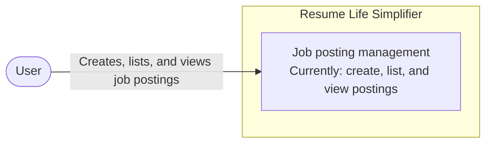
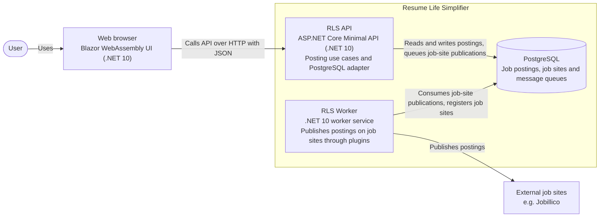

# System Name
Resume life simplifier

# Contributors
- [Stéphane Denommé](https://github.com/CurlyFire)
- [Julien-Claude Diallo](https://github.com/AI-nakinSkywalker)

# Project Board
https://github.com/orgs/dialden/projects/3

# Licence
MIT

## System structure

### Architecture diagrams

#### System context diagram


#### Container diagram


## Tech stack
Programming language: C#

Frameworks: .Net 10, Blazor webassembly

Database: PostgreSQL

## UI flow

From Home, choose **View postings** to open the postings list. Choose
**Create posting** from that list, enter a title, and submit the form.
Successful creation returns to the refreshed postings list; errors remain on
the creation page. Select a posting's title in the list to view its details.
The creation and details pages link back to the postings list.

The UI uses a responsive career-workspace layout with persistent **Overview**
and **Job postings** navigation, an opportunity library with a live posting
count, and dedicated creation and detail panels. Navigation moves above the
content on smaller screens. Loading, empty, and error states are shown in
context; the interface only displays the posting information currently supported
by the system.

UI acceptance-test page objects inherit shared workspace navigation from
`BasePage`. The UI client loads the app once with Playwright's `GotoAsync`;
subsequent returns home click **Overview**, allowing Blazor to navigate without
restarting the WebAssembly app.

### Publishing and external destinations

Select a draft posting in the library and choose **Publish selected**. In the
confirmation dialog, optionally select Jobillico and choose **Confirm
publication**. **Cancel** closes the dialog without publishing or saving channel
choices. With no destinations selected, publication is
local to RLS. A published posting cannot be published again; the UI disables the
action and the API returns HTTP 409 for another attempt.

The dialog's **Publishing channels** section uses selectable job-site cards and
a demo notice. Publication errors remain in the dialog; its controls are disabled
while publication is in progress.

The API advertises `GET /job-sites` through the `list-job-sites` entry-point link.
It returns the job sites registered by the Worker, for example
`[{"id":"jobillico","name":"Jobillico"}]`, and none until the Worker has started once. Publish with
`PATCH /postings/{id}`:

```json
{
  "status": "Published",
  "jobSiteIds": ["jobillico"]
}
```

Omitting `jobSiteIds` is equivalent to an empty selection. Identifiers are
case-sensitive; unknown, duplicate, or null selections return HTTP 400 with a
`jobSiteIds` validation error. The posting's publication and its per-site
job-site publication requests are saved atomically. Concurrent publication
attempts cannot create duplicate job-site publications.

Publishing, viewing, and listing responses include `jobSitePublications`, for example
`[{"jobSiteId":"jobillico","status":"Pending"}]`. A publication stays `Pending` until
the Worker gets the job site's response, then becomes `Succeeded` or `Failed`; the
publish response is therefore always `Pending`. The UI shows these outcomes in
the list and posting details. Postings without external destinations have an
empty `jobSitePublications` collection.

Publication saves a MassTransit command for each selected site in the EF Core
transactional outbox, in the same transaction as the posting and job-site
publication records. The API does not wait for transport delivery. The Worker
forwards committed commands to the durable PostgreSQL queue
`rls-job-site-publication`; pending outbox work is retried and survives restarts.
Publishing without external destinations creates no job-site publication commands.

### Worker and job-site plugins

The Worker (`DialDen.RLS.Worker.Root`) is a separate process. It consumes the
job-site publication commands and publishes each posting on its job site through
a plugin. A plugin implements `IJobSite` from `DialDen.RLS.JobSites.Abstractions`
(identifier, name, and `Publish`) and is registered in the Worker's composition
root, the only project referencing plugins. The only plugin is Jobillico
(`DialDen.RLS.JobSites.Jobillico`), which is not implemented for the demo: its
publications always become `Failed`.

At startup, the Worker registers its plugins in the `job_sites` table. Job sites
it no longer has are kept but become unavailable, so the API stops offering them.
Run a single Worker per database; Workers with different plugins would undo each
other's registrations.

When a job site rejects a posting (the plugin throws), its publication becomes
`Failed` without retrying. A publication whose job site is unavailable also
fails. The Worker's own errors, such as a lost database connection, are retried
a few times, then the command moves to the queue's error queue. Each command is
processed at most once, in the same transaction as its publication's outcome,
through MassTransit's EF Core inbox. The plugin is called within that
transaction, which is acceptable for the demo.

The Worker reads configuration from environment variables prefixed with
`RLS_WORKER_` and command-line arguments, like the API. It requires
`ConnectionStrings:RLS`. `Messaging:JobSitePublicationQueue` (default
`rls-job-site-publication`) names the queue, and must match the API's setting.
Commands queued while the Worker is stopped are processed when it starts.

Apply all Flyway migrations, including
[V3](src/system/Database/migrations/V3__Add_posting_deliveries.sql),
[V4](src/system/Database/migrations/V4__Add_messaging_transport_and_outbox.sql),
[V5](src/system/Database/migrations/V5__Queue_existing_pending_deliveries.sql),
[V6](src/system/Database/migrations/V6__Rename_deliveries_to_job_site_publications.sql),
[V7](src/system/Database/migrations/V7__Pin_job_site_publication_message_type.sql) and
[V8](src/system/Database/migrations/V8__Add_job_sites.sql),
before running the updated API, Worker or tests.
V5 queues previously recorded Pending job-site publications without duplicating commands
already present in the outbox or destination queue. V6 renames the deliveries table
to `job_site_publications` and the queued command to `PublishPostingOnJobSite`.
V7 moves queued commands to the command's pinned message type,
`urn:message:DialDen.RLS.Messaging:PublishPostingOnJobSite`, and V8 adds the
`job_sites` catalog. Stop API and Worker hosts while applying the migrations.

### Posting pagination

The posting library uses server-side paging with **10 postings per page**, ordered
by identifier. The badge shows the total number of postings, not just the current
page's size. Previous/Next links and a range such as **Showing 11-20 of 23
postings** identify the current slice. Page links use `/postings?page=2`, so
refreshing or using browser history preserves the selected page. Creating a
posting returns to the first page; newly created postings appear at the end of
the identifier-ordered library.

`GET /postings?pageNumber=2` returns a page envelope rather than the previous flat
array (an API response-shape change):

```json
{
  "items": [{ "id": 11, "title": "Software Engineer" }],
  "totalCount": 11,
  "pageNumber": 2,
  "pageSize": 10
}
```

Omitting `pageNumber` selects page 1. Non-positive, non-integer, or out-of-range
integer page numbers return HTTP 400. A valid page number beyond the last page
returns an empty `items` array with the actual `totalCount`. EF Core reads the
count and the limited page in a repeatable-read transaction, keeping both values
consistent for that request.

Core represents identified opportunities with `Posting` and listing results with
`PostingList` (`Postings` and `TotalPostings`). Its `IPostingsArchive` contract uses
page numbers and postings per page; the `EntityFrameworkPostingsArchive`
infrastructure adapter owns pagination and persistence through a scoped EF Core
context. Core and its contracts remain independent of EF Core.

### Persistence

Application persistence uses EF Core with the Npgsql PostgreSQL provider, rather
than direct Npgsql commands. The context maps the existing `postings` table,
including its identity identifier and text-based posting status. The
`ConnectionStrings:RLS` setting remains unchanged.

Flyway remains the schema owner. Application startup does not create the
database, run EF migrations, or modify its schema. Continue adding schema changes
under `src/system/Database/migrations`. Test database safety checks and cleanup
continue using the underlying Npgsql driver.

### Background messaging

MassTransit **8.5.12** is pinned for this POC. Its packages declare Apache-2.0
licensing and provide .NET 10 / EF Core 10 support. MassTransit v9 requires a
commercial license; upgrading to v9 is not part of this implementation.

The transport reuses `ConnectionStrings:RLS`, with its objects in the `transport`
schema. EF outbox/inbox tables live in `messaging`. These schemas are separate
from the application tables in `public`, but use the same PostgreSQL database.
No separate message broker or additional connection setting is required.

Flyway V4 contains the PostgreSQL transport SQL derived from the pinned
MassTransit version and outbox DDL generated from its EF model. The transport
SQL's [Apache license](src/system/Database/licenses/MassTransit-LICENSE.txt) is
included. Application startup does not create or migrate these schemas.
Coordinate future MassTransit package upgrades with a new Flyway migration;
do not edit an already-applied migration. The migration account needs schema,
table, sequence, and function creation permissions. The runtime account needs
access to the messaging/transport tables and sequences and permission to execute
transport functions.

The API only writes commands to the outbox. The Worker runs the outbox delivery
service and the consumers. Dispatch is at-least-once; the Worker's inbox and the
publication's `Pending` status ignore repeated commands.

## Repository Strategy
Mono-Repo

# Contribute
## Software requirements
### Windows
- [Windows Subsystem for Linux](https://learn.microsoft.com/en-us/windows/wsl/install)
- [Docker desktop](https://www.docker.com/products/docker-desktop/)
- [Visual Studio Code](https://code.visualstudio.com/)
    - [Dev containers extension](https://marketplace.visualstudio.com/items?itemName=ms-vscode-remote.remote-containers)
- [VcXsrv - Open-Source X Server for Windows](https://vcxsrv.com/)

### Linux
- Docker
- [Visual Studio Code](https://code.visualstudio.com/)
    - [Dev containers extension](https://marketplace.visualstudio.com/items?itemName=ms-vscode-remote.remote-containers)

## Build, run and test the application
### Prerequisites
- Make sure you have installed the [software requirements](#software-requirements)
- Clone the repository
- Open the cloned folder within Visual Studio Code
- Reopen the folder inside a devcontainer (Visual Studio's Dev container extension should detect the devcontainer configuration)

### Configure the development environment
The dev container reads its local settings from
[`.devcontainer/.env`](.devcontainer/.env). Edit that file before creating or
rebuilding the container:

| Variables | Purpose |
|-----------|---------|
| `POSTGRES_DB`, `POSTGRES_USER`, `POSTGRES_PASSWORD` | Local PostgreSQL setup |
| `RLS_DEV_DATABASE`, `RLS_TEST_DATABASE` | Separate databases for development and tests |
| `PGHOST`, `PGPORT` | PostgreSQL address used inside the Compose network |
| `API_HTTP_URL`, `API_HTTPS_URL`, `UI_HTTP_URL`, `UI_HTTPS_URL` | API and UI launch URLs |
| `API_PROJECT_FILE`, `UI_PROJECT_FILE` | Project filenames used to generate VS Code launch settings |
| `ASPNETCORE_ENVIRONMENT` | ASP.NET Core environment |
| `TEST_HOSTING_MODE` | Test hosting mode: `InProcess` (default) or `External` |

The checked-in `.env` contains disposable local-development defaults. Do not put
production credentials in it. If `TEST_HOSTING_MODE` is `External`, configure
`RLS_TEST_Hosting__APIUrl` and `RLS_TEST_Hosting__UIUrl` in the container
environment as well. Rebuild the dev container after changing environment
values; setup regenerates the Git-ignored launch settings. See the
[development container guide](.devcontainer/README.md) for details.

### Build and run the application
- Make sure you have completed the [Prerequisites](#Prerequisites)
#### From Visual Studio Code
- Select **API + Worker + UI** in Run and Debug and press F5. It starts the API, the Worker and a browser on the UI address

### Build and run the tests
- Make sure you have completed the [Prerequisites](#Prerequisites)

The shared acceptance-test fixture empties `job_site_publications`, `postings`,
outbox/inbox records, and transport message/delivery records and resets the
posting identity sequence once before each test run (including filtered runs).
It preserves schemas, transport topology and the `job_sites` catalog, and does
not clear data between scenarios. Cleanup requires
`RLS_TEST_DATABASE` and `RLS_DEV_DATABASE` and refuses connections that do not
target the named test database or that target the development database.
Real and Stubbed connections are checked before cleanup; identical connections
are cleaned only once. Do not run simultaneous test runs against the same
database. With external hosting, ensure the external API uses this same test
database configuration.

With in-process hosting, each test environment also hosts the Worker, started
before the API, with its own queue (`rls-job-site-publication-stubbed` or
`-real`) so the environments never consume each other's commands. The Worker
reads `<ENVIRONMENT>_RLS_WORKER_` variables, such as
`STUBBED_EXT_SYSTEMS_RLS_WORKER_ConnectionStrings__RLS`. The stubbed environment
replaces the Worker's job sites with a stub that scenarios control with
`Given().JobSite("jobillico").AcceptsPostings()` or `.RejectsPostings()`, and
`Given().JobSite("jobillico").HasResponded()` waits until the job site has
answered the scenario's postings. These scenarios need in-process hosting; they
do not pass with external hosting yet, including in the commit pipeline.

#### Run Playwright tests with the browser inspector
The tracked runsettings file is
[`.vscode/default.runsettings`](.vscode/default.runsettings). To use it in VS
Code Test Explorer, set `dotnet.unitTests.runSettingsPath` to
`.vscode/default.runsettings` in VS Code's User or Workspace settings. To open
the Playwright Inspector and run the browser headed:

1. Open the runsettings file and change `<PWDEBUG>0</PWDEBUG>` to
   `<PWDEBUG>1</PWDEBUG>`.
2. In Test Explorer, select a UI-channel acceptance test and choose **Debug
   Test**. UI-channel tests launch the browser; API-channel tests do not.
3. Use the Playwright Inspector to step through browser actions. To debug C#
   test code, set breakpoints and use **Debug Test**.
4. Restore `PWDEBUG` to `0` when finished so normal test runs use headless
   browser behavior.

The same runsettings can be used from the repository root with:

```sh
dotnet test src/tests/DialDen.RLS.Tests/DialDen.RLS.Tests.csproj --settings .vscode/default.runsettings
```

For the browser inspector, set `PWDEBUG` to `1` in the runsettings before
running the command. Headed browser tests need the dev container's display
connection to be available. For more information about test hosting, see the
[development container guide](.devcontainer/README.md#test-hosting).
