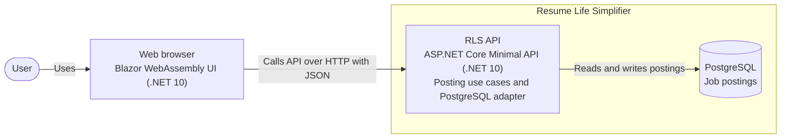

# System Name
Resume life simplifier

# Contributors
- [Stéphane Denommé](https://github.com/CurlyFire)
- [Julien-Claude Diallo](https://github.com/AI-nakinSkywalker)

# Project Board
https://github.com/orgs/dialden/projects/3

# Licence
MIT

## System structure

### Architecture diagrams

#### System context diagram


#### Container diagram


## Tech stack
Programming language: C#

Frameworks: .Net 10, Blazor webassembly

Database: PostgreSQL

## UI flow

From Home, choose **View postings** to open the postings list. Choose
**Create posting** from that list, enter a title, and submit the form.
Successful creation returns to the refreshed postings list; errors remain on
the creation page. Select a posting's title in the list to view its details.
The creation and details pages link back to the postings list.

## Repository Strategy
Mono-Repo

# Contribute
## Software requirements
### Windows
- [Windows Subsystem for Linux](https://learn.microsoft.com/en-us/windows/wsl/install)
- [Docker desktop](https://www.docker.com/products/docker-desktop/)
- [Visual Studio Code](https://code.visualstudio.com/)
    - [Dev containers extension](https://marketplace.visualstudio.com/items?itemName=ms-vscode-remote.remote-containers)
- [VcXsrv - Open-Source X Server for Windows](https://vcxsrv.com/)

### Linux
- Docker
- [Visual Studio Code](https://code.visualstudio.com/)
    - [Dev containers extension](https://marketplace.visualstudio.com/items?itemName=ms-vscode-remote.remote-containers)

## Build, run and test the application
### Prerequisites
- Make sure you have installed the [software requirements](#software-requirements)
- Clone the repository
- Open the cloned folder within Visual Studio Code
- Reopen the folder inside a devcontainer (Visual Studio's Dev container extension should detect the devcontainer configuration)

### Configure the development environment
The dev container reads its local settings from
[`.devcontainer/.env`](.devcontainer/.env). Edit that file before creating or
rebuilding the container:

| Variables | Purpose |
|-----------|---------|
| `POSTGRES_DB`, `POSTGRES_USER`, `POSTGRES_PASSWORD` | Local PostgreSQL setup |
| `RLS_DEV_DATABASE`, `RLS_TEST_DATABASE` | Separate databases for development and tests |
| `PGHOST`, `PGPORT` | PostgreSQL address used inside the Compose network |
| `API_HTTP_URL`, `API_HTTPS_URL`, `UI_HTTP_URL`, `UI_HTTPS_URL` | API and UI launch URLs |
| `API_PROJECT_FILE`, `UI_PROJECT_FILE` | Project filenames used to generate VS Code launch settings |
| `ASPNETCORE_ENVIRONMENT` | ASP.NET Core environment |
| `TEST_HOSTING_MODE` | Test hosting mode: `InProcess` (default) or `External` |

The checked-in `.env` contains disposable local-development defaults. Do not put
production credentials in it. If `TEST_HOSTING_MODE` is `External`, configure
`RLS_TEST_Hosting__APIUrl` and `RLS_TEST_Hosting__UIUrl` in the container
environment as well. Rebuild the dev container after changing environment
values; setup regenerates the Git-ignored launch settings. See the
[development container guide](.devcontainer/README.md) for details.

### Build and run the application
- Make sure you have completed the [Prerequisites](#Prerequisites)
#### From Visual Studio Code
- Just press F5 and the debug task will start the application and a browser on the server address

### Build and run the tests
- Make sure you have completed the [Prerequisites](#Prerequisites)

#### Run Playwright tests with the browser inspector
The tracked runsettings file is
[`.vscode/default.runsettings`](.vscode/default.runsettings). To use it in VS
Code Test Explorer, set `dotnet.unitTests.runSettingsPath` to
`.vscode/default.runsettings` in VS Code's User or Workspace settings. To open
the Playwright Inspector and run the browser headed:

1. Open the runsettings file and change `<PWDEBUG>0</PWDEBUG>` to
   `<PWDEBUG>1</PWDEBUG>`.
2. In Test Explorer, select a UI-channel acceptance test and choose **Debug
   Test**. UI-channel tests launch the browser; API-channel tests do not.
3. Use the Playwright Inspector to step through browser actions. To debug C#
   test code, set breakpoints and use **Debug Test**.
4. Restore `PWDEBUG` to `0` when finished so normal test runs use headless
   browser behavior.

The same runsettings can be used from the repository root with:

```sh
dotnet test src/tests/DialDen.RLS.Tests/DialDen.RLS.Tests.csproj --settings .vscode/default.runsettings
```

For the browser inspector, set `PWDEBUG` to `1` in the runsettings before
running the command. Headed browser tests need the dev container's display
connection to be available. For more information about test hosting, see the
[development container guide](.devcontainer/README.md#test-hosting).
