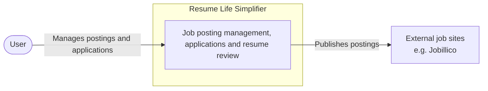
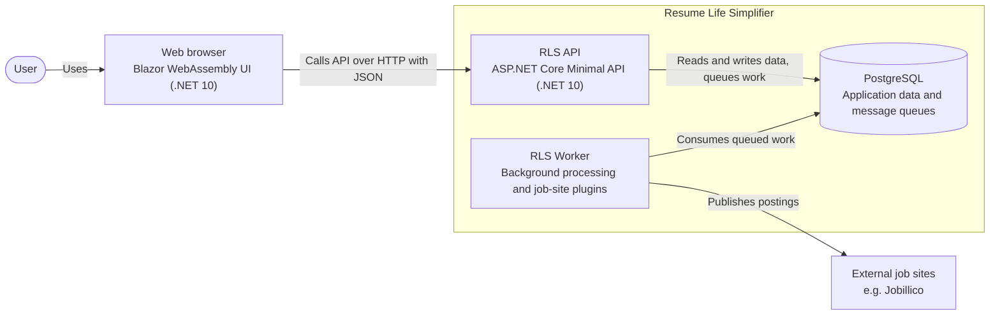

# System Name
Resume life simplifier

# Contributors
- [Stéphane Denommé](https://github.com/CurlyFire)
- [Julien-Claude Diallo](https://github.com/AI-nakinSkywalker)

# Project Board
https://github.com/orgs/dialden/projects/3

# Licence
MIT

## System structure

### Architecture diagrams

#### System context diagram


#### Container diagram


## Tech stack
Programming language: C#

Frameworks: .NET 10, Blazor WebAssembly

Database: PostgreSQL

### Education requirement

A posting may include one optional free-text education requirement specified at
creation. It appears on the public listing after publication and is passed to
the selected job sites. The API exposes `requiredEducation` on posting creation
and views. Blank values mean no requirement; other text is preserved.

The Jobillico adapter sends this text in `sskills_en`, matching the posting's
existing default language, and marks the education criterion completed. It
recognizes certain explicit diploma names and abbreviations, optionally followed
by a field of study, and otherwise leaves the diploma and level unspecified.
This inference is best-effort and does not interpret arbitrary free text; review
the result in Jobillico. For example, `Baccalauréat en génie logiciel` maps to a
bachelor's degree, whereas `DEC ou baccalauréat en informatique` is left
unspecified.
Jobillico sandbox verification is still needed for the competencies display and
for a completed criterion without a recognized diploma.

# Contribute
## Software requirements
### Windows
- [Windows Subsystem for Linux](https://learn.microsoft.com/en-us/windows/wsl/install)
- [Docker Desktop](https://www.docker.com/products/docker-desktop/)
- [Visual Studio Code](https://code.visualstudio.com/)
    - [Dev Containers extension](https://marketplace.visualstudio.com/items?itemName=ms-vscode-remote.remote-containers)
- [VcXsrv - Open-Source X Server for Windows](https://github.com/marchaesen/vcxsrv/releases)

### Linux
- Docker
- [Visual Studio Code](https://code.visualstudio.com/)
    - [Dev Containers extension](https://marketplace.visualstudio.com/items?itemName=ms-vscode-remote.remote-containers)

## Build, run and test the application
### Prerequisites
- Make sure you have installed the [software requirements](#software-requirements)
- Clone the repository
- Open the cloned folder in Visual Studio Code
- Reopen the folder inside a dev container when prompted

### Configure the development environment
The dev container reads its local settings from
[`.devcontainer/.env`](.devcontainer/.env). Edit that file before creating or
rebuilding the container:

| Variables | Purpose |
|-----------|---------|
| `POSTGRES_DB`, `POSTGRES_USER`, `POSTGRES_PASSWORD` | Local PostgreSQL setup |
| `RLS_DEV_DATABASE`, `RLS_TEST_DATABASE` | Separate databases for development and tests |
| `PGHOST`, `PGPORT` | PostgreSQL address used inside the Compose network |
| `API_HTTP_URL`, `API_HTTPS_URL`, `UI_HTTP_URL`, `UI_HTTPS_URL` | API and UI launch URLs |
| `API_PROJECT_FILE`, `UI_PROJECT_FILE` | Project filenames used to generate VS Code launch settings |
| `ASPNETCORE_ENVIRONMENT` | ASP.NET Core environment |
| `TEST_HOSTING_MODE` | Test hosting mode: `InProcess` (default) or `External` |

The checked-in `.env` contains disposable local-development defaults. Do not put
production credentials in it. If `TEST_HOSTING_MODE` is `External`, configure
`RLS_TEST_Hosting__APIUrl` and `RLS_TEST_Hosting__UIUrl` in the container
environment as well. Rebuild the dev container after changing environment
values; setup regenerates the Git-ignored launch settings. See the
[development container guide](.devcontainer/README.md) for details.

### Build and run the application
- Make sure you have completed the [Prerequisites](#prerequisites)

#### From Visual Studio Code
- Select **API + Worker + UI** in Run and Debug and press F5.

### Build and run the tests
- Make sure you have completed the [Prerequisites](#prerequisites)
- Run `dotnet test src/tests/DialDen.RLS.Tests/DialDen.RLS.Tests.csproj` from the repository root.

The test project uses xUnit.net v3 with the VSTest adapter. The
`xunit.v3.mtp-off` package keeps Microsoft Testing Platform integration disabled
so existing `dotnet test` filters and runsettings remain supported on .NET 10.

#### Test harness migration

The assembly-wide `TestHarness` supports API and UI scenarios with in-process
hosting and either stubbed or real external systems:

```csharp
await harness.For(ExternalSystems.Stubbed).Through(Channel.API)
    .When().CreatePosting().WithTitle("Software Engineer")
    .Then().ShouldSucceed()
        .And().Posting().HasTitle("Software Engineer").HasStatus("Draft");
```

The harness types live in `src/tests/DialDen.RLS.Tests/Fixtures`:

- `TestHarness` is the assembly fixture and composes scenarios' clients, drivers,
  and DSLs.
- `TestHarness` owns a Flyway-migrated database template, shared WireMock
  access, and a lazily created Playwright/browser pair. Private methods
  encapsulate initialization, scenario setup, and cleanup.
- `TestScenarioSelection` captures the external-system mode and interaction
  channel. For fluent scenarios, it opens a `TestScope` only when the scenario
  is awaited, then disposes it even if an assertion fails.
- `TestScope` owns the scenario's DI scope, root service provider, and
  environment, and disposes them in that order. The DSL uses the scoped
  services without owning their lifetime.
- `TestEnvironment` owns a cloned database, separate API and worker hosts,
  a UI host when needed, and the scenario's WireMock mappings and request logs.
  After stopping its hosts, it uses `IDatabaseCleanup` to drop the clone and
  removes the scoped mappings and logs. Drivers configure the mappings but
  don't own their cleanup. Real-system environments retain their configured
  external endpoints rather than redirecting them to WireMock.

`TestHarness` exposes only `For(...)` to scenarios. xUnit manages initialization
and disposal through explicitly implemented lifecycle interfaces. The returned
selection exposes `Through(...)` for fluent scenarios and `ThroughUI()` for
UI-only presentation checks. `ThroughUI()` returns a `ScopedUIClient` that
forwards the full `IUIClient` API. Disposing the proxy with `await using`
disposes the scenario's `TestScope`; the underlying `UIClient` is responsible
only for its browser context:

```csharp
await using var ui = await harness.For(ExternalSystems.Stubbed).ThroughUI();
var homePage = await ui.OpenHomePage();
```

Assembly initialization migrates a uniquely named template once. Each awaited
scenario gets a clone; cleanup removes only that scenario's database and stub
mappings/request logs. Assembly disposal drops the template.
WireMock request-log cleanup is serialized per server within the test process
to avoid its shared journal's concurrent-deletion race; scenarios remain parallel.

To compare a timing-sensitive failure with and without concurrency, run the
same test filter with `-- xUnit.MaxParallelThreads=1 xUnit.ParallelAlgorithm=conservative`
and then with `xUnit.MaxParallelThreads=8`.

WireMock forwards the full scenario-prefixed request path to the held
resume-analysis callback, so the callback must listen on that same path.

The configured test database supplies connection settings but is not truncated or used for
scenario data. The test role needs database-creation permissions and access to
the `postgres` maintenance database. Flyway must be on `PATH`, and PostgreSQL
must be reachable over TCP.

All acceptance and smoke scenarios use the harness; there is no collection
fixture or paused migration block. Each UI scenario gets an isolated browser
context; closing it does not close the assembly's shared browser. API-only
runs do not launch Playwright. xUnit uses `ParallelMode.All` with a four-test
concurrency cap, allowing methods and theory rows in the same class to overlap
without sharing application hosts, databases, browser state, or stub mappings.
Scheduling is configured in
[xunit.runner.json](src/tests/DialDen.RLS.Tests/xunit.runner.json).
Real-system coverage currently consists of the existing smoke scenarios.
Externally hosted environments are not supported by the harness yet.

#### Run Playwright tests with the browser inspector
The tracked runsettings file is
[`.vscode/default.runsettings`](.vscode/default.runsettings). To use it in VS
Code Test Explorer, set `dotnet.unitTests.runSettingsPath` to
`.vscode/default.runsettings` in VS Code's User or Workspace settings. To open
the Playwright Inspector and run the browser headed:

1. Open the runsettings file and change `<PWDEBUG>0</PWDEBUG>` to
   `<PWDEBUG>1</PWDEBUG>`.
2. In Test Explorer, select a UI-channel acceptance test and choose **Debug
   Test**. UI-channel tests launch the browser; API-channel tests do not.
3. Use the Playwright Inspector to step through browser actions. To debug C#
   test code, set breakpoints and use **Debug Test**.
4. Restore `PWDEBUG` to `0` when finished so normal test runs use headless
   browser behavior.

The same runsettings can be used from the repository root with:

```sh
dotnet test src/tests/DialDen.RLS.Tests/DialDen.RLS.Tests.csproj --settings .vscode/default.runsettings
```

For the browser inspector, set `PWDEBUG` to `1` in the runsettings before
running the command. Headed browser tests need the dev container's display
connection to be available. For more information about test hosting, see the
[development container guide](.devcontainer/README.md#test-hosting).
